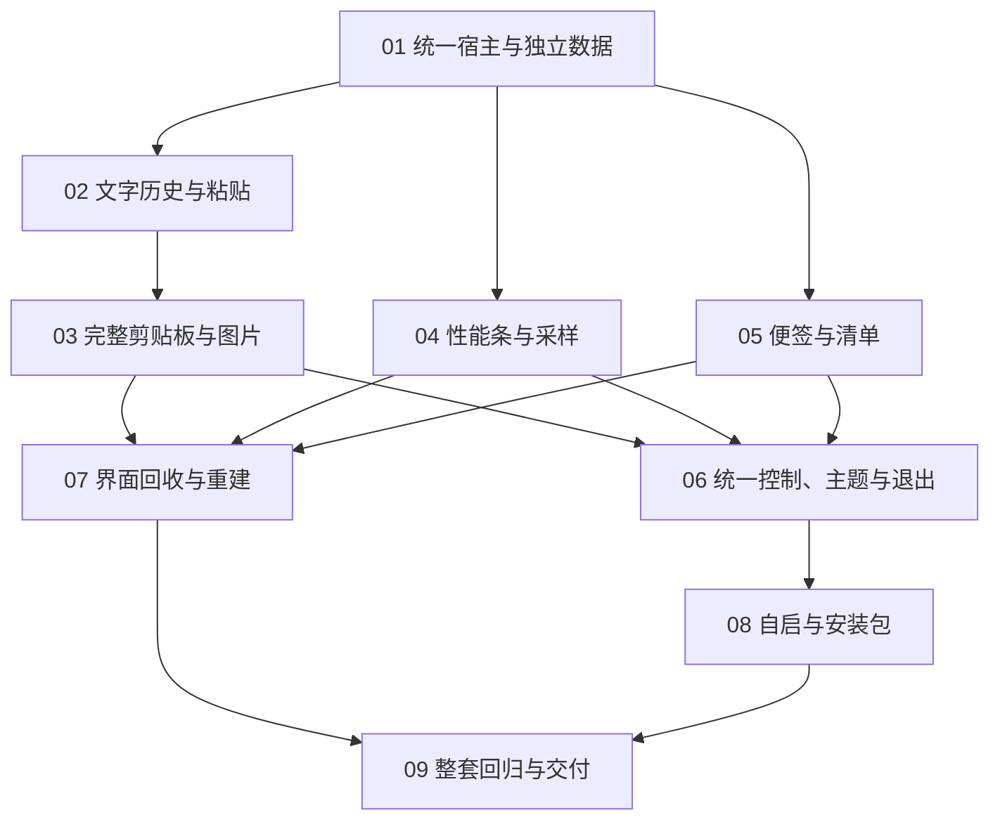

# 工单索引与依赖

正式规格：[工具套件合并规格](../spec.md)。发布日期：2026-10-21。用户已确认下列九项拆分和依赖；所有工单当前为 `ready-for-agent`，尚未开始实现。

`ready-for-agent` 表示规格与验收条件已具备实施准备度，实际开始仍须满足该工单的 `Blocked by`。完成前置工单时记录真实验证结果；后续实现不能省略各工单自身的功能测试。

| 编号 | 工单 | 直接前置 |
| --- | --- | --- |
| 01 | [统一宿主与独立数据启动](01-host-and-independent-data.md) | 无 |
| 02 | [快捷键驱动的文字历史与粘贴](02-text-history-and-paste.md) | 01 |
| 03 | [完整剪贴板管理与图片能力](03-full-clipboard-and-images.md) | 02 |
| 04 | [性能条与按指标采样](04-performance-bar-and-sampling.md) | 01 |
| 05 | [独立便签与清单操作](05-notes-and-checklists.md) | 01 |
| 06 | [统一控制、主题与安全退出](06-unified-controls-theme-and-exit.md) | 03、04、05 |
| 07 | [隐藏界面回收与重复重建](07-window-recycling-and-recreation.md) | 03、04、05 |
| 08 | [统一开机启动与自包含安装包](08-autostart-and-installer.md) | 06 |
| 09 | [整套功能回归与交付说明](09-functional-regression-and-handoff.md) | 07、08 |

## 依赖图

## 执行约定

- 当前仅 01 没有前置条件。01 完成后可分别开展 02、04、05；03 在 02 完成后开始。
- 06 与 07 均等待三个工具接入完成，两者没有必需先后关系。08 等待统一控制完成，09 等待回收与安装完成。
- 各工单通过真实控制入口、窗口交互及隔离数据结果验证；09 负责最终产物的整套功能回归。
- 新套件从空白独立数据开始，不能补回旧目录复用、自动迁移、自动备份或旧启动项接管需求。
- 不增加内存基线、专项配对比较或固定内存门槛。保留按需创建、回收、采样及取消工作的功能要求。
- 实施和验证结果写回对应工单，未运行的 UAC、登录、多显示器或硬件场景明确标注，不能记录为通过。
