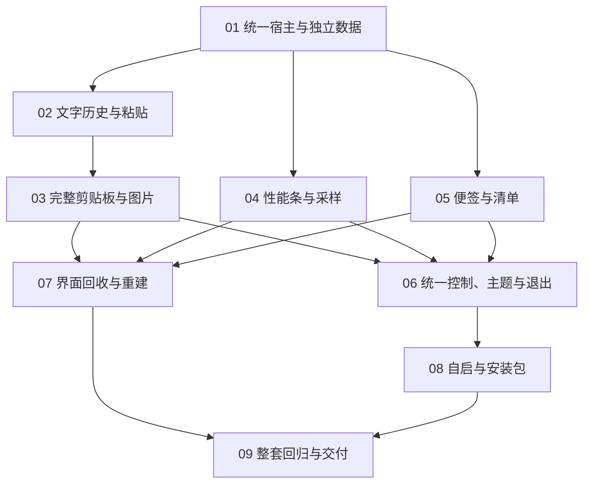

# 工单索引与依赖

正式规格：[工具套件合并规格](../spec.md)。发布日期：2026-10-21。九项工单已全部实施完毕，
状态均为 `resolved`，各工单顶部的“实施结果”记录实际产出与检查入口；
最终整套回归、安装包冒烟与交付说明见[工单 09 验证](../docs/validation/ticket-09.md)与[交付说明](../docs/handoff.md)。

`resolved` 表示实现与已验证的自动检查已落地，验证文档中逐项标注的人工场景（真实 UAC、登录自启、
多显示器/DPI、硬件缺失等）**未执行即不视为通过**，复验步骤见对应验证文档。后续修改须重跑受影响工单
列出的检查入口，不能用本索引的完成状态替代实际证据。

合并后的代码审查修复（安装器事务回滚、性能条设置托管、剪贴板高对比度、版本与标识单一真源等）
已并入实现，逐项判定与证据见[审查修复记录](../docs/validation/code-review-fixes.md)；受影响的
工单 03、04、06、08 顶部“实施结果”已同步检查数字与行为变化。

后续的视觉重构（按 `docs/UI Design` 的 Apple 亮暗参考稿重建全部可视窗口）落地映射见
[视觉规范](../docs/design-system.md)，改动覆盖工单 02～08 的全部界面，检查入口不变：
剪贴板 `ClipboardTool.Tests` + `ToolSuite.ClipboardChecks`、性能 `PerfMonitor.*.Tests`、
便签 `Pinto.*Checks`、宿主 `ToolSuite.SuiteChecks`/`LifecycleChecks`、安装器 `ToolSuite.InstallerChecks`。

| 编号 | 工单 | 直接前置 | 状态 |
| --- | --- | --- | --- |
| 01 | [统一宿主与独立数据启动](01-host-and-independent-data.md) | 无 | resolved |
| 02 | [快捷键驱动的文字历史与粘贴](02-text-history-and-paste.md) | 01 | resolved |
| 03 | [完整剪贴板管理与图片能力](03-full-clipboard-and-images.md) | 02 | resolved |
| 04 | [性能条与按指标采样](04-performance-bar-and-sampling.md) | 01 | resolved |
| 05 | [独立便签与清单操作](05-notes-and-checklists.md) | 01 | resolved |
| 06 | [统一控制、主题与安全退出](06-unified-controls-theme-and-exit.md) | 03、04、05 | resolved |
| 07 | [隐藏界面回收与重复重建](07-window-recycling-and-recreation.md) | 03、04、05 | resolved |
| 08 | [统一开机启动与自包含安装包](08-autostart-and-installer.md) | 06 | resolved |
| 09 | [整套功能回归与交付说明](09-functional-regression-and-handoff.md) | 07、08 | resolved |

## 依赖图

## 执行约定

- 依赖顺序已按图执行完毕：01 建立宿主，02/04/05 分别接入三个工具，03 在 02 之后补全剪贴板，06 与 07 并行完成统一控制与界面回收，08 完成自启与安装包，09 执行最终整套回归。
- 各工单已通过真实控制入口、窗口交互及隔离数据结果验证；09 使用最终构建与安装产物完成整套回归与交付说明。
- 后续修改须重跑受影响工单列出的检查入口，并在对应验证文档追加新证据。
- 新套件从空白独立数据开始，不能补回旧目录复用、自动迁移、自动备份或旧启动项接管需求。
- 不增加内存基线、专项配对比较或固定内存门槛。保留按需创建、回收、采样及取消工作的功能要求。
- 实施和验证结果写回对应工单，未运行的 UAC、登录、多显示器或硬件场景明确标注，不能记录为通过。
